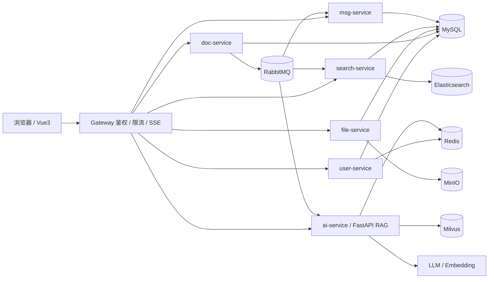

# MZ-KnowBase

面向中小企业的**多租户私有知识库 + RAG 问答平台**。以「文档沉淀 + 权限控制 + 可溯源 AI 问答」为核心，支持 Docker Compose 私有化部署，业务数据与向量数据均可留在企业内网。

> 当前状态：**设计阶段**。仓库目前仅包含需求、技术、开发计划三份基线文档；`backend/`、`frontend/`、`deploy/` 目录为预留骨架，代码将按里程碑 M0 → M11 逐步落地。

## 核心能力

- **统一沉淀**：平台 Markdown 文档与飞书文档 / 多维表格进入同一知识目录，支持全量与增量同步。
- **权限感知检索**：召回后、送入大模型前按文档级 ACL 过滤，AI 只基于当前用户有权访问的内容回答。
- **答案可查**：SSE 流式回答，每条回答附带文档标题、片段与原文跳转入口。
- **持续更新**：文档发布后经 MQ 触发切片、Embedding 与全文索引，保证问答内容不过期。
- **多租户隔离**：默认共享库共享表 + `tenant_id` 过滤，预留独立库模式。
- **私有部署**：模型调用通过适配器解耦，开发默认 Ollama，生产可切换任意 OpenAI 兼容接口。

## 技术栈

| 层次 | 选型 |
| --- | --- |
| 后端 | JDK 17、Spring Boot 3.3.x、Spring Cloud 2023.0.x、Nacos 2.3.x、Gateway、MyBatis-Plus 3.5.x |
| AI 服务 | Python 3.11、FastAPI、LangChain 0.3.x、pymilvus、sentence-transformers（默认 `BAAI/bge-small-zh-v1.5`，512 维） |
| 前端 | Vue 3.5 + TypeScript、Vite 5、Pinia、Vue Router 4、MZ-UI、pnpm workspace（V1.1 接入 qiankun） |
| 中间件 | MySQL 8.0、Redis 7.2 + Redisson、RabbitMQ 3.12、Elasticsearch 8.15、Milvus 2.4、MinIO、XXL-JOB |
| 可观测 | Actuator + Micrometer + Prometheus/Grafana、Micrometer Tracing + Zipkin |

## 架构概览



设计原则：

1. MySQL 是唯一事实源，Milvus 与 ES 均为**可重建索引**。
2. `ai-service` 不直连业务库，不持有用户与权限事实数据。
3. 所有外部请求只能经 Gateway 进入，内部接口需校验内部令牌。
4. 文档主流程使用本地事务 + Outbox，跨服务链路最终一致、可幂等、可补偿。

## 仓库结构

```text
mz-knowbase/
├─ backend/            # Maven 聚合工程：mz-common / mz-api / mz-gateway / mz-server(+ 拆分后的各微服务)
├─ frontend/           # pnpm workspace：apps/mz-base-main 及子应用、packages/mz-ui
├─ ai-service/         # FastAPI RAG 服务（M6 起落地）
├─ deploy/             # docker-compose-dev.yml、mysql/init、nacos、nginx、prometheus、scripts
└─ doc/
   ├─ 01-需求文档.md    # 产品范围、角色权限、功能与非功能需求、验收标准
   ├─ 02-技术文档.md    # 架构、数据模型、接口、消息、RAG 与部署设计
   └─ 03-开发计划.md    # M0-M11 里程碑与任务拆分
```

实施期先以**模块化单体**推进：业务代码在单一 Spring Boot 进程内按 `user/doc/file/search/msg` 包边界组织，业务稳定后再拆分为独立服务；前端先做单应用，页面稳定后再拆 qiankun 子应用。拆分只调整启动类、依赖、配置与路由，不重写业务逻辑。

## 服务与端口

| 应用 | 语言 | 端口 | 说明 |
| --- | --- | --- | --- |
| gateway | Java | 8080 | 统一网关 |
| mz-server | Java | 18080 | 开发期模块化单体入口（拆分后移除） |
| user-service | Java | 18081 | 租户、用户、RBAC、飞书配置 |
| doc-service | Java | 18082 | 文档、版本、ACL、会话、同步编排 |
| file-service | Java | 18083 | 分片上传、文件元数据、下载签名 |
| search-service | Java | 18084 | ES 索引与关键词搜索 |
| msg-service | Java | 18085 | 站内通知 |
| ai-service | Python | 18090 | 切片、向量化、RAG、飞书拉取 |
| mz-base-main | Vue | 5173 | 前端基座 / 开发期单应用 |
| sub-doc / sub-file / sub-feishu / sub-ai-chat / sub-system | Vue | 5174-5178 | 微前端子应用（V1.1） |

## 快速开始

### 环境要求

| 项目 | 要求 |
| --- | --- |
| JDK / Maven | 17 / 3.9+ |
| Python | 3.11 |
| Node.js / pnpm | 20 LTS / 9+ |
| Docker | Docker Desktop，启用 Compose v2 |
| 资源 | 内存 ≥ 16 GB（推荐 24 GB），SSD 预留 40 GB+ |

### 启动步骤（随 M0 里程碑提供）

```bash
# 1. 启动中间件：Nacos / MySQL / Redis / RabbitMQ / ES / Milvus / MinIO ...
docker compose -f deploy/docker-compose-dev.yml up -d

# 2. 启动后端网关与业务服务
mvn -f backend/pom.xml -pl mz-gateway,mz-server -am spring-boot:run

# 3. 启动 AI 服务
cd ai-service && python -m venv .venv && source .venv/bin/activate && pip install -e . \
  && uvicorn app.main:app --port 18090 --reload

# 4. 启动前端
cd frontend && pnpm install && pnpm --filter mz-base-main dev
```

启动后：

- 前端：<http://localhost:5173>
- 网关：<http://localhost:8080/api/v1/ping>
- Nacos / RabbitMQ / MinIO / Attu / Zipkin 等控制台地址见《开发计划》M0 验收清单

> 开发环境需在 `.env` 或 Nacos 中提供 `MZ_JWT_SECRET`、`MZ_INTERNAL_TOKEN`、`MZ_MYSQL_*`、`MZ_REDIS_*`、`MZ_MILVUS_*`、`MZ_ES_URI`、`MZ_MINIO_*`、`MZ_LLM_*`、`MZ_EMBEDDING_*` 等配置。**严禁在仓库中提交真实密钥。**

## 开发路线图

| 里程碑 | 内容 | 可演示结果 |
| --- | --- | --- |
| M0 | 环境与工程骨架 | 一条命令启动中间件，Java / Python / 前端骨架可访问 |
| M1 | 登录、租户与 RBAC | 登录、用户与角色管理、权限拦截 |
| M2 | 文档闭环 | 目录、Markdown 文档、发布、版本、回收站、ACL |
| M3 | 文件能力 | 分片上传、断点续传、绑定文档、签名下载 |
| M4 | 飞书同步 | 配置、全量 / 增量同步、资源级日志 |
| M5 | 全文搜索 | ES 检索、权限过滤、手动重建 |
| M6 | AI 索引流水线 | 切片、Embedding、Milvus 写入、索引状态 |
| M7 | RAG 问答 | SSE 回答、引用溯源、多轮会话、权限感知检索 |
| M8 | 前端整合与 MVP 联调 | 完整业务闭环，可演示 MVP |
| M9 | 微服务拆分 | Gateway + 5 个 Java 服务 + AI 服务独立运行 |
| M10 | qiankun 微前端 | 基座 + 5 个子应用独立开发部署 |
| M11 | 稳定性、CI 与交付 | 监控、补偿、镜像、CI、备份与验收材料 |

MVP 核心开发量约 84.5 个有效日，含缓冲约 20 周；完整交付约 105 个有效日。详见《03-开发计划》。

## 开发约定

- 主分支 `main` 始终保持可启动；功能分支命名 `feat/<module>-<topic>`。
- 提交信息格式：`feat|fix|docs|test|chore(scope): summary`，数据库脚本、接口与业务代码同提交。
- 所有业务表含 `tenant_id`、`created_at`、`updated_at`；多租户复合索引中 `tenant_id` 置于首列。
- 主键使用雪花 / 号段 ID，对外不使用可猜测的自增 ID；时间存 UTC，API 使用 ISO-8601。
- Controller 不直接调用 Mapper；事务只放在 application 层，外部 API 调用不进数据库事务。
- 权限变更立即生效，搜索、AI 召回与文件下载都必须实时重新校验。
- 密钥、Token、文档正文不得写入日志；前端不保存任何密钥。

## 文档索引

| 文档 | 内容 |
| --- | --- |
| [01-需求文档.md](./doc/01-需求文档.md) | 产品范围与边界、角色权限、功能与非功能需求、验收标准 |
| [02-技术文档.md](./doc/02-技术文档.md) | 技术栈基线、架构、数据模型、接口、异步消息、RAG 详细设计、部署与安全 |
| [03-开发计划.md](./doc/03-开发计划.md) | M0-M11 里程碑、任务 ID、验收清单与常见阻塞 |

## 许可证

暂未确定，待补充。
