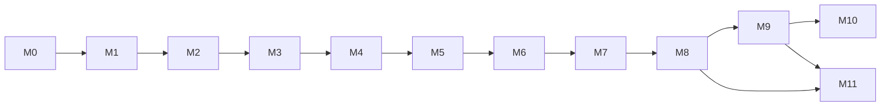

# MZ-KnowBase 开发计划

> 文档版本：V1.0  
> 编写日期：2026-10-26  
> 适用对象：单人全栈开发，全部代码手写  
> 配套文档：[需求文档](./需求文档.md)、[技术文档](./技术文档.md)

## 1. 计划目标与使用方式

### 1.1 计划目标

本计划将 MZ-KnowBase 拆成可独立验收的里程碑。每个里程碑结束时，系统都必须能启动、能演示、能测试，避免“写了几个月但没有任何完整链路”的情况。

计划优先保证以下顺序：

1. 先让环境可重复启动。
2. 先跑通登录与文档业务闭环。
3. 再接入文件、飞书与索引。
4. 再实现 RAG 问答。
5. 最后拆微服务、微前端和补齐运维能力。

### 1.2 如何使用本计划

手写代码时，以任务编号为单位推进，不要按“整章技术点”推进：

1. 每次只领取一个任务 ID。
2. 先写数据库变更、接口契约和验收用例。
3. 再写最小后端实现，用 `curl` 或测试调通。
4. 再写对应前端页面。
5. 补日志、错误码、权限和测试。
6. 提交并打勾，进入下一个任务。

完成一个任务的最低标准：

- [ ] 代码可编译，服务可启动。
- [ ] 接口有请求校验、权限校验和统一错误响应。
- [ ] 数据库变更已写成版本化 SQL。
- [ ] 关键成功路径和失败路径已验证。
- [ ] 日志包含 `traceId`，不泄露密钥或正文。
- [ ] 相关 OpenAPI 或接口说明已更新。

### 1.3 工期假设

| 假设 | 说明 |
| --- | --- |
| 投入强度 | 每天 6～8 小时，每周 5 天 |
| 经验前提 | 熟悉 Java、Spring Boot、Vue3 基础，RAG 需要边学边做 |
| 时间口径 | 下列工期为“有效开发日”，不含长时间等待飞书审核 |
| 缓冲 | 总工期额外预留 20% 用于调试、返工和环境问题 |
| 交付目标 | MVP 先模块化单体 + 单前端，V1 再拆微服务和 qiankun |

结论：

- **MVP 核心开发量约 84.5 个有效日，含缓冲约 20 周。**
- **完成微服务拆分、qiankun 和完整运维后约 105 个有效日，含缓冲约 25 周。**
- 如果每天只能投入 3 小时，整体时间按 2～2.5 倍估算。

## 2. 范围冻结

### 2.1 MVP 必须完成

1. 租户、用户、登录、角色与权限。
2. 文件夹、Markdown 文档、版本、回收站、文档权限。
3. 文件分片上传、断点续传、受控下载。
4. 飞书配置、全量同步、增量同步、资源级日志。
5. ES 全文搜索。
6. 文档切片、Embedding、Milvus 索引。
7. RAG 问答、SSE、引用溯源、权限过滤。
8. 单 Vue 应用的前端页面。
9. Docker Compose 启动、健康检查、基础监控。
10. 关键安全测试与冒烟测试。

### 2.2 MVP 明确不做

1. qiankun 微前端拆分。
2. 独立库租户自动开通。
3. Seata 全局事务。
4. 富文本编辑器、多人实时协作。
5. LDAP/OIDC/企业微信单点登录。
6. Office 在线预览、病毒扫描、计费。
7. 多模型路由和复杂 Prompt 管理后台。

> 这些能力不是删除，而是放到 V1.1/V2。MVP 期间不要用“顺手做一下”破坏节奏。

## 3. 总体里程碑

| 里程碑 | 目标 | 工期 | 累计 | 可演示结果 |
| --- | --- | --- | --- | --- |
| M0 | 环境与工程骨架 | 7 天 | 7 天 | 一条命令启动中间件，Java/Python/前端骨架可访问 |
| M1 | 登录、租户与 RBAC | 8.5 天 | 15.5 天 | 管理员登录、创建用户、分配角色、权限拦截 |
| M2 | 文档闭环 | 12.5 天 | 28 天 | 建目录、写文档、发布、版本、回收站、ACL |
| M3 | 文件能力 | 8.5 天 | 36.5 天 | 分片上传、断点续传、绑定文档、签名下载 |
| M4 | 飞书同步 | 10.5 天 | 47 天 | 配置飞书、全量/增量同步、任务日志 |
| M5 | 全文搜索 | 6 天 | 53 天 | 文档发布后可搜索、权限过滤、手动重建 |
| M6 | AI 索引流水线 | 8 天 | 61 天 | 文档切片、Embedding、Milvus 写入、索引状态 |
| M7 | RAG 问答 | 11 天 | 72 天 | SSE 回答、引用、多轮会话、权限感知检索 |
| M8 | 前端整合与 MVP 联调 | 12.5 天 | 84.5 天 | 单前端完整业务闭环，可演示 MVP |
| M9 | 微服务拆分 | 5.5 天 | 90 天 | Gateway + 五个 Java 服务 + AI 服务独立运行 |
| M10 | qiankun 微前端 | 6 天 | 96 天 | 基座 + 五个子应用独立开发与部署 |
| M11 | 稳定性、CI 与交付 | 9 天 | 105 天 | 监控、补偿、镜像、CI、备份、验收材料 |

依赖关系：



> M5 与 M6 顺序可互换，但都必须依赖 M2 的文档发布事件。M11 的测试和监控应贯穿全程，不能最后才补。

## 4. M0：环境与工程骨架（7 天）

### 4.1 目标

建立可重复的本地环境、代码仓库、公共模块和最小启动链路。完成后能确认“不是环境问题”，再进入业务开发。

### 4.2 任务

| ID | 任务 | 产出 | 工时 |
| --- | --- | --- | --- |
| M0-01 | 安装并校验 JDK17、Maven、Python3.11、Node20、pnpm、Docker | 版本检查记录 | 0.5 天 |
| M0-02 | 初始化 Git、目录、`.gitignore`、`.editorconfig` | 仓库骨架 | 0.5 天 |
| M0-03 | 编写 `docker-compose-dev.yml`，启动 Nacos/MySQL/Redis/RabbitMQ/ES/Milvus/MinIO | 可重复启动的基础环境 | 2 天 |
| M0-04 | 初始化 Maven 聚合工程、公共模块、统一返回体与异常 | `mz-common` 可测试 | 1 天 |
| M0-05 | 初始化 `mz-server` 模块化单体、`mz-gateway`、健康检查 | 两个进程可启动 | 1 天 |
| M0-06 | 初始化 `ai-service` FastAPI 与 `/health` | Python 服务可启动 | 0.5 天 |
| M0-07 | 初始化单前端 Vue3 + Vite + Pinia + Router | 页面可打开 | 0.5 天 |
| M0-08 | 编写 MySQL 初始化脚本、Nacos 命名空间说明、MinIO Bucket 脚本 | 初始化文档与脚本 | 1 天 |

### 4.3 建议文件

```text
backend/pom.xml
backend/mz-common/common-core/
backend/mz-common/common-security/
backend/mz-common/mybatis-plus-starter/
backend/mz-common/redis-starter/
backend/mz-server/
backend/mz-gateway/
ai-service/app/main.py
ai-service/pyproject.toml
frontend/apps/mz-base-main/
deploy/docker-compose-dev.yml
deploy/mysql/init/001_schema.sql
deploy/scripts/check-env.sh
```

### 4.4 手写顺序

1. 先写环境检查脚本，确保版本失败能明确报错。
2. 写 Compose，一个组件一个组件启动，不要一次全开。
3. 先起 MySQL、Redis、RabbitMQ，再起 Nacos、ES、Milvus、MinIO。
4. 写公共返回体和全局异常，先用一个测试 Controller 验证。
5. 写 Gateway 到 `mz-server` 的固定路由，验证 `/api/v1/ping`。
6. 写 Python `/health` 和前端空 Layout。
7. 最后补初始化 SQL 和控制台检查清单。

### 4.5 验收

- [ ] `docker compose -f deploy/docker-compose-dev.yml up -d` 后所有容器健康。
- [ ] Nacos、MySQL、RabbitMQ、MinIO、Attu、Zipkin 控制台可访问。
- [ ] `mz-server`、`mz-gateway`、`ai-service`、前端可分别启动。
- [ ] 请求 `http://localhost:8080/api/v1/ping` 返回统一响应体。
- [ ] 重启电脑后按 README 步骤能恢复环境。
- [ ] 仓库中没有真实密码和密钥。

### 4.6 常见阻塞

| 问题 | 处理 |
| --- | --- |
| Milvus/ES 内存不足 | 关闭不用的服务，限制 ES 堆，确认 Docker 内存 ≥ 8 GB |
| Nacos 起不来 | 先检查数据库配置和端口 8848/9848 |
| Apple Silicon 镜像架构错误 | 使用 arm64 兼容镜像，不要混用 amd64-only 镜像 |
| 端口冲突 | 按技术文档端口表统一修改，不允许临时代码写死 |

## 5. M1：登录、租户与 RBAC（8.5 天）

### 5.1 目标

完成租户隔离基础、账号登录、JWT、菜单/按钮权限和用户管理。此阶段结束后，后续所有接口都必须能从登录态获得 `tenantId` 和 `userId`。

### 5.2 任务

| ID | 任务 | 产出 | 工时 |
| --- | --- | --- | --- |
| M1-01 | 建 `sys_tenant/sys_user/sys_role/sys_menu` 及关联表 | 迁移 SQL | 1 天 |
| M1-02 | 实现租户、用户、角色、菜单实体与 Mapper | 数据访问层 | 1 天 |
| M1-03 | 实现密码哈希、登录、JWT 签发、登出黑名单 | Auth API | 1.5 天 |
| M1-04 | 实现 `TenantContext`、JWT Filter、Gateway 头注入与防伪造 | 租户上下文链路 | 1 天 |
| M1-05 | 实现 MyBatis-Plus 多租户插件 | 自动 `tenant_id` 过滤 | 1 天 |
| M1-06 | 实现 RBAC 菜单树、权限标识、`@RequiresPerm` | 功能权限 | 1 天 |
| M1-07 | 实现用户/角色管理接口与登录页 | 可操作后台 | 1.5 天 |
| M1-08 | 登录失败锁定、用户停用、Token 失效测试 | 安全用例 | 0.5 天 |

### 5.3 关键类

```text
common-security/
  JwtTokenProvider
  JwtAuthenticationFilter
  LoginUser
  TenantContext
  RequiresPerm
  PermissionAspect

user/
  AuthController
  UserController
  RoleController
  MenuController
  SysUserService
  SysRoleService
  TenantLineHandler
```

### 5.4 手写顺序

1. 写 DDL 与种子数据：一个平台管理员、一个演示租户、一个租户管理员。
2. 写实体和 Mapper，只做单表查询。
3. 写密码哈希与登录 Service，不接 JWT。
4. 接 JWT 签发和解析，单测 `sub/tenantId/ver/jti/exp`。
5. 接 Gateway 过滤器，验证伪造 `X-Tenant-Id` 会被覆盖。
6. 接 `TenantContext` 和 MyBatis 插件，用两个租户的数据验证隔离。
7. 写菜单/角色/用户接口，再写前端登录页、Layout 和用户管理页。
8. 补失败用例、日志和 Trace ID。

### 5.5 验收

- [ ] 正确账号可登录，错误账号不暴露“用户是否存在”。
- [ ] Token 过期、退出、用户停用后立即失效。
- [ ] 两个租户互相查不到用户、角色、菜单。
- [ ] 无权限访问接口返回 403，不返回数据后再由前端隐藏。
- [ ] 角色变更后重新登录或刷新权限立即生效。
- [ ] 登录、登出、创建用户、分配角色均有审计日志。

### 5.6 测试清单

| 类型 | 用例 |
| --- | --- |
| 单元 | Token 生成/解析、密码校验、权限表达式匹配 |
| 集成 | 登录 → 带 Token 访问 `/auth/me` |
| 安全 | 伪造租户头、过期 Token、停用用户旧 Token |
| UI | 登录失败提示、菜单按权限渲染、401 跳转 |

## 6. M2：文档闭环（12.5 天）

### 6.1 目标

完成目录、文档、版本、权限、回收站和 Outbox 事件，形成第一个可演示业务闭环。

### 6.2 任务

| ID | 任务 | 产出 | 工时 |
| --- | --- | --- | --- |
| M2-01 | 建 `doc_folder/doc_info/doc_version/doc_acl/doc_share/doc_operation_log/outbox_event` | 迁移 SQL | 1.5 天 |
| M2-02 | 实现目录树：创建、移动、删除、路径防循环 | Folder API | 1.5 天 |
| M2-03 | 实现文档 CRUD、草稿、发布、乐观锁 | Doc API | 2 天 |
| M2-04 | 实现版本快照、列表、恢复 | Version API | 1 天 |
| M2-05 | 实现文档 ACL、继承规则、批量权限判定 | 权限 Service | 1.5 天 |
| M2-06 | 实现回收站、恢复、彻底删除 | Trash API | 1 天 |
| M2-07 | 实现 Outbox 写入与 Dispatcher | 可靠事件 | 1 天 |
| M2-08 | 文档列表、编辑器、版本、权限、回收站页面 | 前端页面 | 2 天 |
| M2-09 | 权限、并发、回收站、Outbox 测试 | 测试与修复 | 1 天 |

### 6.3 关键类

```text
doc/
  FolderController / FolderService
  DocController / DocService
  DocVersionService
  DocPermissionService
  DocAclMapper
  DocOutboxService
  DocEventPublisher
  DocOperationLogAspect
```

### 6.4 手写顺序

1. 先写目录树，不接权限，只验证父子关系与路径。
2. 写文档草稿 CRUD，只允许所有者访问。
3. 加发布、版本号、乐观锁和索引状态字段。
4. 写 ACL 判定，并用 6 组组合用例验证。
5. 写回收站与彻底删除，删除时只投事件，不直接操作 ES/Milvus。
6. 写 Outbox，用假 MQ 或日志 Dispatcher 验证事件生成。
7. 最后写前端页面；编辑页先只支持 Markdown 文本与预览。

### 6.5 验收

- [ ] 建目录、子目录、移动、删除、恢复顺序正确。
- [ ] 同级移动不会形成自身/子孙循环。
- [ ] 文档保存有乐观锁，冲突返回明确错误。
- [ ] 发布后 `indexStatus=PENDING`，事件写入 Outbox。
- [ ] 私有、租户可见、指定用户/角色四种场景权限正确。
- [ ] 回收站文档不返回给普通搜索列表。
- [ ] 权限变化后旧授权立即失效。
- [ ] 所有删除和权限变更可审计。

### 6.6 前端页面

1. 文档目录树 + 文档列表。
2. Markdown 编辑器 + 预览 + 保存状态。
3. 文档信息面板：可见范围、所有者、版本、索引状态。
4. 版本抽屉、回收站页面、权限设置弹窗。
5. 无权限、版本冲突、已删除、索引失败四类状态页。

## 7. M3：文件能力（8.5 天）

### 7.1 目标

完成文件分片上传、断点续传、MinIO 存储、文档绑定和受控下载。

### 7.2 任务

| ID | 任务 | 产出 | 工时 |
| --- | --- | --- | --- |
| M3-01 | 建 `file_info/file_upload_task`，初始化 MinIO Bucket | 迁移与配置 | 0.5 天 |
| M3-02 | 实现上传初始化、秒传判断、分片位图 | Upload API | 1 天 |
| M3-03 | 实现分片校验、临时对象写入、断点查询 | Chunk API | 1.5 天 |
| M3-04 | 实现流式合并、文件元数据落库、清理临时分片 | Merge Service | 1.5 天 |
| M3-05 | 实现文件绑定、列表、签名下载、权限校验 | File API | 1 天 |
| M3-06 | 实现超时分片清理任务 | 定时任务 | 0.5 天 |
| M3-07 | 文件上传与文档附件页面 | 前端页面 | 1.5 天 |
| M3-08 | 大文件、分片乱序、重复合并、越权下载测试 | 测试与修复 | 1 天 |

### 7.3 手写顺序

1. 先用小文件验证 MinIO 连接和签名 URL。
2. 写初始化与单分片上传，不合并。
3. 写分片位图和断点查询。
4. 写流式合并，先用 10 MB 文件测试。
5. 接文档权限，再做 500 MB 测试。
6. 最后写前端并发上传队列和失败重试。

### 7.4 验收

- [ ] 5 MB 分片可乱序上传，缺失分片不能合并。
- [ ] 错误 MD5 或长度被拒绝。
- [ ] 重复调用合并只产生一个文件。
- [ ] 相同 SHA-256 文件可秒传。
- [ ] 下载 URL 5 分钟过期，越权用户无法获取。
- [ ] 清理任务不会误删已合并文件。
- [ ] 500 MB 文件上传过程服务内存稳定。

## 8. M4：飞书同步（10.5 天）

### 8.1 目标

完成飞书配置、全量与增量同步。先用 Mock 适配器打通链路，再接真实飞书应用。

### 8.2 任务

| ID | 任务 | 产出 | 工时 |
| --- | --- | --- | --- |
| M4-01 | 建 `sys_feishu_config/feishu_sync_task/feishu_sync_item` | 迁移 SQL | 1 天 |
| M4-02 | 实现配置保存、AES-GCM 加密、脱敏读取、连通性测试 | Config API | 1 天 |
| M4-03 | 定义 FeishuClient 接口与 Mock 实现 | 可测试适配器 | 1 天 |
| M4-04 | 实现全量同步任务、租户互斥、资源分页 | Sync Service | 1.5 天 |
| M4-05 | 实现文档/多维表格转 Markdown、附件下载 | 解析适配器 | 1.5 天 |
| M4-06 | 实现幂等 upsert、资源日志、任务统计 | 落库链路 | 1 天 |
| M4-07 | 实现增量游标、定时任务、失败重试 | 增量同步 | 1 天 |
| M4-08 | 飞书配置与任务页 | 前端页面 | 1.5 天 |
| M4-09 | 限流、超时、部分失败、重复同步测试 | 测试与修复 | 1 天 |

### 8.3 手写顺序

1. 先定义飞书客户端接口和 DTO，不接 SDK。
2. 写 Mock 客户端返回固定文档、多维表格、分页与 429。
3. 用 Mock 跑通配置 → 任务 → 拉取 → upsert → 事件。
4. 接真实飞书 token、文档读取和表格读取。
5. 再实现增量游标和定时任务。
6. 最后写前端任务日志和重试操作。

### 8.4 飞书适配注意事项

1. 不在日志中打印 `tenant_access_token`。
2. 按资源分页，不一次性拉全量列表。
3. 资源标题不作为唯一键。
4. 附件先下载到临时位置，再上传 MinIO。
5. 429 使用指数退避；401 刷新 token 后重试一次。
6. 单个资源失败不能导致整任务回滚。

### 8.5 验收

- [ ] App Secret 只写不读，数据库为密文，接口脱敏。
- [ ] 连通性测试可区分凭证错误、权限不足、网络错误。
- [ ] 全量同步 100 条 Mock 资源正确写入。
- [ ] 重复同步不产生重复文档，版本或更新时间正确。
- [ ] 同一租户不能并发同步。
- [ ] 单个资源失败，任务状态为 `PARTIAL`，可单独重试。
- [ ] 增量同步只处理游标后的资源。
- [ ] 飞书来源文档在平台内只读。

## 9. M5：全文搜索（6 天）

### 9.1 目标

让已发布文档可以在 60 秒内被关键词检索，并保证搜索结果按权限过滤。

### 9.2 任务

| ID | 任务 | 产出 | 工时 |
| --- | --- | --- | --- |
| M5-01 | 编写 ES 索引 Mapping、分词器配置与初始化脚本 | 索引模板 | 0.5 天 |
| M5-02 | 实现 MQ 消费者、文档内容拉取、ES upsert/delete | 索引消费者 | 1 天 |
| M5-03 | 实现搜索接口、分页、字段高亮、筛选 | Search API | 1 天 |
| M5-04 | 实现候选文档批量权限过滤 | 搜索权限 | 1 天 |
| M5-05 | 实现手动重建索引与进度查询 | Rebuild API | 0.5 天 |
| M5-06 | 搜索页面、结果高亮、空状态 | 前端页面 | 1 天 |
| M5-07 | 索引幂等、删除、乱序、权限测试 | 测试与修复 | 1 天 |

### 9.3 手写顺序

1. 先写 Mapping，发布一条测试文档并手工写入 ES。
2. 实现 `GET /search` 的最小查询，不接权限。
3. 接 MQ 消费者，验证更新和删除。
4. 接权限过滤，用有权限/无权限两个用户对比。
5. 写高亮与筛选，再写前端。
6. 最后补重建索引和失败重试。

### 9.4 验收

- [ ] 发布文档后 60 秒内可搜索到。
- [ ] 修改标题和正文后搜索结果更新。
- [ ] 删除文档后搜索不到，且旧索引被清理。
- [ ] 无权限用户搜索不到受限文档，也不返回标题片段。
- [ ] 中文专有名词、编号、英文缩写均有合理结果。
- [ ] ES 不可用时接口返回降级错误，不返回未过滤数据。

## 10. M6：AI 索引流水线（8 天）

### 10.1 目标

完成 Python 服务的文档消费、清洗、切片、Embedding 和 Milvus 写入，使文档进入 `READY` 状态。

### 10.2 任务

| ID | 任务 | 产出 | 工时 |
| --- | --- | --- | --- |
| M6-01 | 搭建 ai-service 配置、日志、HTTP 客户端、健康检查 | 服务骨架 | 0.5 天 |
| M6-02 | 实现 RabbitMQ 消费者、手动 ACK、幂等与重试 | 消费框架 | 1 天 |
| M6-03 | 实现 Java 内部内容接口客户端、版本校验 | 数据获取 | 0.5 天 |
| M6-04 | 实现 Markdown 清洗、标题路径解析、空内容处理 | 清洗模块 | 1 天 |
| M6-05 | 实现标题感知切片、Chunk 元数据、确定性 ID | 切片模块 | 1.5 天 |
| M6-06 | 实现 Embedding 适配器与批量调用 | Embedding 模块 | 1 天 |
| M6-07 | 初始化 Milvus Collection、写入、删除旧版本 | 向量模块 | 1 天 |
| M6-08 | 上报索引状态、失败记录、重试任务 | 状态回写 | 0.5 天 |
| M6-09 | 切片、幂等、版本更新、Embedding 失败测试 | 测试与修复 | 1 天 |

### 10.3 手写顺序

1. 先写一个本地文本切片脚本，不接 MQ。
2. 用固定 Markdown 验证标题路径、表格和代码块。
3. 接 Embedding，先只处理一个 Chunk。
4. 接 Milvus，验证插入、查询、删除。
5. 接 MQ 和 Java 内容接口，跑通完整 `PENDING → READY`。
6. 加版本幂等和失败重试。
7. 最后加指标和日志。

### 10.4 验收

- [ ] 同一事件重复消费只产生一份向量。
- [ ] 文档更新后只保留新版本向量，旧版本被清理。
- [ ] 文档删除后 Milvus 不再返回该文档片段。
- [ ] 切片保留标题路径，表格和代码块不被破坏。
- [ ] 空文档、超长文档、特殊字符不会导致消费者卡死。
- [ ] 索引失败可重试，状态和错误原因可见。
- [ ] 1 MB 文档 P95 在 60 秒内完成索引。

## 11. M7：RAG 问答（11 天）

### 11.1 目标

完成权限感知的混合检索、Prompt 编排、LLM 流式调用、引用溯源和会话保存。

### 11.2 任务

| ID | 任务 | 产出 | 工时 |
| --- | --- | --- | --- |
| M7-01 | 建 `ai_chat_session/ai_chat_message`，实现会话内部接口 | 会话存储 | 1 天 |
| M7-02 | 实现问题规范化、问题 Embedding、Milvus 召回 | 向量召回 | 0.5 天 |
| M7-03 | 实现 search-service 内部召回接口 | 关键词召回 | 0.5 天 |
| M7-04 | 实现去重、RRF 融合、轻量重排 | 混合排序 | 1 天 |
| M7-05 | 实现批量权限过滤、候选重新分组 | 安全过滤 | 1 天 |
| M7-06 | 实现 Prompt 组装、Token 预算、历史裁剪 | Prompt 模块 | 1 天 |
| M7-07 | 实现 LLM 适配器、重试、熔断、限流 | 模型调用 | 1 天 |
| M7-08 | 实现 SSE meta/citation/delta/done/error | 流式输出 | 1 天 |
| M7-09 | 实现引用映射、无依据拒答、消息异步保存 | 回答后处理 | 1 天 |
| M7-10 | 问答页面、引用面板、停止生成、历史会话 | 前端页面 | 2 天 |
| M7-11 | Mock LLM、越权、无答案、超时、注入测试 | 测试与修复 | 1 天 |

### 11.3 手写顺序

1. 先做无 LLM 的“检索结果调试接口”，打印召回内容与分数。
2. 接权限过滤，确保调试结果也不展示越权片段。
3. 写 Prompt，先用固定 Mock LLM 返回固定文本。
4. 接真实 Ollama，验证流式返回。
5. 写 SSE 事件；前端先只显示 delta。
6. 加 citation、done、error 和停止生成。
7. 最后接会话历史与多轮上下文。

### 11.4 验收

- [ ] 回答只使用当前用户可见文档。
- [ ] 无依据问题明确拒答，不生成外部知识。
- [ ] 每条可回答问题的引用至少 1 条，且链接可打开。
- [ ] 越权用户对同一问题的引用列表不同。
- [ ] SSE 顺序稳定，客户端断开后服务端停止调用模型。
- [ ] LLM 超时/熔断有明确错误事件。
- [ ] 多轮会话不超过配置的上下文预算。
- [ ] Prompt 注入测试不能改变系统规则。

### 11.5 RAG 调试数据

准备 3 个测试用户和 6 份文档：

| 用户 | 可见范围 |
| --- | --- |
| admin | 全部 |
| alice | 公开文档 + 角色 A 文档 |
| bob | 公开文档 + 自己创建的私有文档 |

固定问题至少覆盖：可直接回答、需要跨文档、无答案、权限敏感、文档更新后、Prompt 注入。

## 12. M8：前端整合与 MVP 联调（12.5 天）

### 12.1 目标

把前七个里程碑的前端页面整合为一个可演示的 Vue 单应用，完成登录态、路由、权限、错误处理和端到端流程。

### 12.2 任务

| ID | 任务 | 产出 | 工时 |
| --- | --- | --- | --- |
| M8-01 | MZ-UI 最小组件集、统一 Layout、侧边栏、顶部导航、面包屑、租户信息 | 应用外壳 | 1 天 |
| M8-02 | 统一路由守卫、401/403/404、登录过期处理 | 路由与鉴权 | 1 天 |
| M8-03 | 统一请求封装、错误提示、加载状态、重试 | 基础设施 | 1 天 |
| M8-04 | 完成工作台：最近文档、同步状态、失败提醒 | 首页 | 1 天 |
| M8-05 | 完成文档模块所有交互与状态 | 文档 UI | 2 天 |
| M8-06 | 完成文件模块上传队列、断点续传、附件列表 | 文件 UI | 1.5 天 |
| M8-07 | 完成飞书配置向导与任务日志 | 飞书 UI | 1 天 |
| M8-08 | 完成 AI 会话、SSE、引用、反馈、移动端基本适配 | AI UI | 2 天 |
| M8-09 | 统一空态、错误态、骨架屏、加载骨架 | 体验完善 | 1 天 |
| M8-10 | Playwright 冒烟测试、跨浏览器检查、MVP 演示脚本 | 联调验收 | 1 天 |

### 12.3 手写顺序

1. 先统一所有页面外壳，不做业务新功能。
2. 把各模块的 API 调用集中到 `shared/api`，删除页面内零散 Axios。
3. 统一登录态和权限指令。
4. 逐模块走通真实后端，不依赖 Mock。
5. 补错误态和空态。
6. 最后写 E2E 冒烟和演示脚本。

### 12.4 MVP 验收脚本

1. 管理员登录，创建用户和角色。
2. 创建目录和 Markdown 文档，保存、发布。
3. 上传一个附件，绑定文档，下载并校验内容。
4. 通过 Mock 飞书执行全量同步，检查任务统计和资源日志。
5. 修改文档并发布，等待 `READY`，搜索到新内容。
6. 提一个问题，收到流式回答和引用，点击引用打开原文。
7. 用无权限用户重复问题，确认引用和正文均不可见。
8. 删除文档，确认搜索、问答和下载均不可用。
9. 查看通知、审计日志和 Trace。
10. 重启服务，确认数据与未完成任务可恢复。

### 12.5 MVP 退出标准

- [ ] 需求文档第 10 章的功能验收全部通过。
- [ ] 关键安全用例通过。
- [ ] 所有 P0 页面无阻塞性错误。
- [ ] 核心接口有自动化冒烟。
- [ ] `docker compose` 可从干净环境启动。
- [ ] README 能指导新机器完成部署。

## 13. M9：微服务拆分（5.5 天）

### 13.1 目标

将模块化单体按已冻结的包边界拆成 Gateway、user-service、doc-service、file-service、search-service、msg-service 和 ai-service。

### 13.2 拆分原则

1. 先拆启动和配置，不重写业务逻辑。
2. 每个服务只保留自己的 Controller、Service、Mapper 和表。
3. 共享 DTO 移到 `mz-api`，不直接共享实体。
4. 服务间优先使用 HTTP；异步事件继续走 MQ。
5. 数据库可以先共用实例，但按服务限制表访问权限。

### 13.3 任务

| ID | 任务 | 产出 | 工时 |
| --- | --- | --- | --- |
| M9-01 | 创建五个服务启动类、依赖、Dockerfile、配置 | 独立进程 | 1 天 |
| M9-02 | 迁移包与启动配置，删除 `mz-server` 聚合启动 | 服务边界 | 1 天 |
| M9-03 | Nacos 注册、Gateway 路由、健康检查 | 服务发现 | 0.5 天 |
| M9-04 | 抽取 Feign 客户端与内部接口鉴权 | 服务调用 | 1 天 |
| M9-05 | 配置每个服务的数据库账号与连接池 | 数据访问 | 0.5 天 |
| M9-06 | 逐链路回归：登录、文档、文件、搜索、问答 | 集成测试 | 1 天 |
| M9-07 | 更新部署 Compose、端口、日志和 README | 交付文档 | 0.5 天 |

### 13.4 拆分顺序

1. 先拆 user-service，验证登录和权限。
2. 再拆 doc-service，验证文档和 Outbox。
3. 再拆 search-service 和 msg-service。
4. 再拆 file-service，验证上传。
5. 最后确认 ai-service 只通过内部接口访问业务数据。

### 13.5 验收

- [ ] 每个服务可独立启动、注册、健康检查。
- [ ] Gateway 路由与限流生效。
- [ ] 服务重启不影响其他服务启动。
- [ ] 内部接口无令牌时返回 401/403。
- [ ] 拆分前后 API 契约不变，前端只改 Base URL。
- [ ] 无服务跨库直接访问其他服务表。

## 14. M10：qiankun 微前端（6 天）

### 14.1 目标

将单前端按业务域拆为基座和五个子应用，实现独立开发、独立构建和统一鉴权。

### 14.2 任务

| ID | 任务 | 产出 | 工时 |
| --- | --- | --- | --- |
| M10-01 | 建立 pnpm workspace 与共享包 | 工程结构 | 0.5 天 |
| M10-02 | 基座接入 qiankun、菜单、路由分发、登录态 | 基座 | 1 天 |
| M10-03 | 改造五个子应用生命周期、base、publicPath | 子应用 | 1.5 天 |
| M10-04 | 实现 props、request、权限、mitt 事件总线 | 通信 | 1 天 |
| M10-05 | 配置独立 devServer、CORS、Vite 插件 | 开发环境 | 0.5 天 |
| M10-06 | Nginx 多应用静态资源与 API 代理 | 部署 | 0.5 天 |
| M10-07 | 子应用切换、刷新、404、样式隔离、内存泄漏测试 | 验收 | 1 天 |

### 14.3 验收

- [ ] 基座登录后能加载任意子应用。
- [ ] 子应用独立启动、独立构建、独立部署。
- [ ] 刷新 `/doc/xxx`、`/ai-chat/xxx` 不 404。
- [ ] Token 只由基座管理，子应用不自行登录。
- [ ] 子应用卸载后无残留定时器、事件监听和 SSE 连接。
- [ ] 全局样式互不污染。
- [ ] SSE 在 qiankun 子应用中正常流式输出。

## 15. M11：稳定性、CI 与交付（9 天）

### 15.1 目标

把“能运行”提升为“可观测、可恢复、可部署、可验收”。

### 15.2 任务

| ID | 任务 | 产出 | 工时 |
| --- | --- | --- | --- |
| M11-01 | 接入 Prometheus 指标、Grafana 看板、Actuator | 监控 | 1 天 |
| M11-02 | 接入 Micrometer Tracing + Brave + Zipkin | 链路追踪 | 1 天 |
| M11-03 | 实现 Outbox 重投、索引补偿、回收站清理、分片清理 | 补偿任务 | 1.5 天 |
| M11-04 | 实现死信管理、重放脚本、告警规则 | 故障处理 | 1 天 |
| M11-05 | 编写 Dockerfile、生产 Compose、Nginx、健康检查 | 部署包 | 1 天 |
| M11-06 | 编写 CI 流程：lint、test、build、image | 自动构建 | 0.5 天 |
| M11-07 | 安全测试：越权、密钥、文件、Prompt 注入 | 安全报告 | 1 天 |
| M11-08 | 性能测试与基线记录 | 性能报告 | 1 天 |
| M11-09 | 备份恢复、故障演练、README、接口清单 | 交付材料 | 1 天 |

### 15.3 必做故障演练

| 演练 | 预期 |
| --- | --- |
| MQ 停止 5 分钟 | 文档仍保存，Outbox 堆积；恢复后自动补发 |
| LLM 超时/熔断 | SSE 返回错误事件，前端保留已生成内容 |
| Milvus 不可用 | ES 单路降级，响应标记 `degraded=true` |
| ES 不可用 | 向量单路可用；搜索接口明确报错 |
| Redis 重启 | 服务自动重连，锁与限流恢复，无脏数据 |
| MySQL 连接池耗尽 | 请求快速失败并告警，不无限阻塞 |
| 索引任务重复消费 | 不产生重复向量，状态最终正确 |

### 15.4 验收

- [ ] 核心指标可在 Grafana 查看。
- [ ] 一次请求可从 Gateway 追踪到 ai-service 和 MQ 消费。
- [ ] 所有补偿任务有执行日志和失败告警。
- [ ] 生产镜像不含开发依赖和密钥。
- [ ] CI 能在干净环境构建通过。
- [ ] 备份恢复演练成功。
- [ ] 验收文档和演示脚本齐全。

## 16. 每周执行模板

建议每周按以下节奏推进，避免“写了很多但无法验收”：

| 时间 | 工作内容 |
| --- | --- |
| 周一上午 | 选定本周 1～2 个任务 ID，写接口与验收用例 |
| 周一至周三 | 完成后端最小实现，使用 curl/单测调通 |
| 周四 | 完成前端与错误态，补日志、权限、指标 |
| 周五上午 | 回归本周及上一里程碑关键链路 |
| 周五下午 | 更新文档、提交、打 Tag、记录遗留问题 |

每日结束前必须留下：

1. 当前可运行版本。
2. 今日完成的验收项。
3. 明日第一个具体动作。
4. 未解决问题及其影响。

## 17. 测试与质量门禁

### 17.1 测试金字塔

| 层级 | 目标 | 最低要求 |
| --- | --- | --- |
| 单元测试 | 权限、切片、幂等、Token 预算 | 核心逻辑必须覆盖 |
| 集成测试 | 数据库、MQ、Redis、内部接口 | 每个里程碑至少 1 条主链路 |
| 契约测试 | 外部 API 与内部接口 | OpenAPI 可生成、字段兼容 |
| E2E | 登录到问答的完整业务 | MVP 至少 5 条 |
| 安全测试 | 越权、密钥、注入、文件 | 每个里程碑增量执行 |
| 性能测试 | 搜索、索引、上传、问答 | M11 完成基线 |

### 17.2 代码门禁

- [ ] Java 编译无警告性错误，格式检查通过。
- [ ] Python Ruff/类型检查通过。
- [ ] 前端 ESLint/TypeScript 构建通过。
- [ ] 新增接口有鉴权、参数校验、错误码。
- [ ] 新增 SQL 有索引评估。
- [ ] 新增异步任务有幂等键和失败处理。
- [ ] 新增日志不包含敏感信息。

### 17.3 Bug 优先级

| 级别 | 示例 | 处理 |
| --- | --- | --- |
| P0 | 越权、数据丢失、服务不可用 | 立即停止新功能，修复并回归 |
| P1 | 核心链路失败、索引永久不一致 | 当周修复 |
| P2 | 非核心页面错误、提示不准确 | 排入本周或下个迭代 |
| P3 | 样式、文案、体验优化 | 集中处理 |

## 18. 进度控制与降级顺序

如果进度落后，按以下顺序降级，不要临时砍安全能力：

1. 暂停 qiankun，保留单前端。
2. 暂停独立库租户、Seata、SSO、分享链接。
3. 缩减前端视觉打磨，保留完整业务路径。
4. 将 ES 混合召回降级为 Milvus 单路，但保留 RRF 接口。
5. 用 Mock 飞书继续开发，不等待审核。
6. 将高级 Rerank 模型替换为分数融合。
7. 将 Office 预览改为下载。

绝对不能降级：

1. 租户隔离。
2. 文档权限过滤。
3. 密钥保护。
4. 异步幂等与失败可追踪。
5. 数据备份说明。

## 19. 交付清单

### 19.1 代码与配置

- [ ] 后端、AI、前端源码与锁定依赖。
- [ ] 所有数据库迁移脚本。
- [ ] Dockerfile、开发/生产 Compose。
- [ ] Nginx、Nacos、Prometheus、Grafana 配置模板。
- [ ] 环境变量示例 `.env.example`，不含真实密钥。

### 19.2 文档

- [ ] 需求文档、技术文档、开发计划。
- [ ] README：环境要求、启动步骤、常见问题。
- [ ] OpenAPI 导出文件。
- [ ] 数据库 ER 图与表说明。
- [ ] 飞书应用配置步骤。
- [ ] LLM/Embedding 切换说明。
- [ ] 备份恢复和故障演练记录。

### 19.3 验收材料

- [ ] MVP 演示脚本。
- [ ] 安全测试记录（至少覆盖越权与 Prompt 注入）。
- [ ] 性能测试基线。
- [ ] 已知问题与后续计划。
- [ ] 5～10 分钟演示视频或现场演示流程。

## 20. 里程碑检查表

| 里程碑 | 必须通过 | 不通过时的处理 |
| --- | --- | --- |
| M0 | 环境一条命令启动 | 暂停业务开发，先修环境 |
| M1 | 登录、租户隔离、RBAC | 不进入文档模块 |
| M2 | 文档 CRUD、ACL、Outbox | 不接入 ES/Milvus |
| M3 | 分片合并、权限下载 | 不进入飞书 |
| M4 | 幂等同步、资源日志 | 可用 Mock 继续，但不能宣称完成 |
| M5 | 搜索结果权限正确 | 不进入 RAG |
| M6 | 索引幂等、状态正确 | 不进入问答 |
| M7 | 无越权引用、SSE 正确 | 不进入 UI 整合 |
| M8 | MVP 全流程演示 | 不进入微服务拆分 |
| M9 | 契约不变、服务独立 | 撤回拆分，保留单体版本 |
| M10 | 子应用独立运行 | 保留单前端发布 |
| M11 | 监控、补偿、部署、安全 | 不宣布正式交付 |

## 21. 后续版本待办

### V1.1

1. 分享链接与密码、有效期。
2. 问答反馈统计和重新生成。
3. 索引重建管理页、死信重放页。
4. 文档批量操作与导出。
5. 通知偏好、管理告警。
6. 完整 CI/CD 与测试环境自动部署。

### V2

1. 独立库租户自动开通与迁移。
2. OIDC/LDAP/企业微信单点登录。
3. 富文本编辑器与多人协作。
4. 多模型路由、Rerank 服务和成本中心。
5. Office 在线预览、病毒扫描。
6. 知识库统计、热门问题、内容缺口分析。
7. Webhook 与开放 API。

## 22. 最终完成定义

当以下条件全部满足时，项目可称为完成：

1. 全新机器按 README 能在半天内启动完整环境。
2. 新租户可在 10 分钟内完成首批文档导入并提问。
3. 无权限用户无法通过搜索、问答、引用、下载获取受限内容。
4. 文档变更 60 秒内被索引，删除后不再被召回。
5. 飞书同步重复执行不产生重复数据，失败可定位、可重试。
6. LLM 或向量库故障时系统有明确降级与错误提示。
7. 关键请求有 Trace、指标、日志和告警。
8. 所有 P0 验收项有记录，所有 P1/P2 遗留项已登记。


